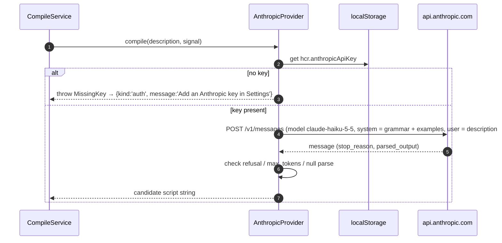

# Design: Flip Card

Status: draft for review. Companion documents: `requirements.md` (what), `tasks.md`
(order of work), `docs/grammar.md` (the language), `.kiro/steering/tech.md` (stack rules).

## 1. Overview

HyperCard Reborn is a TypeScript + Vite single-page application with **no backend at
runtime**. Everything the app needs ships in the static bundle: the parser, the
interpreter, the card store, the flip UI, the editor and the compile service. The only
network call the app ever makes is the one-time compile call to the Anthropic API, and
only when the user has chosen the BYOK (bring your own key) provider. With the offline
canned provider the app makes no network calls at all.

The design is organised around one invariant that satisfies requirements 1.2, 1.3, 2.2
and 3.3 at once:

> **A card's `script` string is the only executable artefact.** The interpreter runs
> the `Program` parsed from that exact string; the flipped card renders that exact
> string; the compile service's only job is to *propose* a new value for it, and the
> card store's `commitScript` is the only code path that can change it, and it refuses
> anything that does not parse.

## 2. Module map

```
src/
  parser/        lexer.ts, parser.ts, ast.ts, errors.ts, printer.ts
  interpreter/   interpreter.ts, values.ts, builtins.ts, host.ts
  store/         cardStore.ts, persistence.ts, types.ts
  compile/       compileService.ts, prompt.ts, providers/anthropic.ts, providers/canned.ts
  examples/      index.ts                      (the six bundled examples, see docs/grammar.md §8)
  ui/            app.ts, frontFace.ts, backFace.ts, editor.ts, errorPanel.ts, settings.ts, dom.ts
  runtime/       cardRuntime.ts               (wires store + interpreter + host; owns "run")
  main.ts
docs/grammar.md                              (imported at build time with `?raw` by compile/prompt.ts)
```

| Module | Responsibility | Depends on | Must not depend on |
|---|---|---|---|
| `parser` | `parse(source): ParseResult` (total function: never throws). `print(program): string` for tests. | nothing | everything else |
| `interpreter` | `run(program, handler, host): RunResult`. Pure over a `Host` interface; no DOM, no store. | `parser` (AST types only) | `compile`, `store`, `ui` |
| `store` | Owns `Card[]`, the `commitScript` invariant, undo of nothing (last valid script is just the current one), persistence to `localStorage`. | `parser` | `compile`, `ui`, `interpreter` |
| `compile` | `compile(description, provider): Promise<CompileResult>`. Calls a provider once, parses the result, returns either a validated script or a `CompileError`. Never writes to the store. | `parser`, `examples`, `@anthropic-ai/sdk` | `store`, `interpreter`, `ui` |
| `examples` | The six `{id, title, description, script}` records. | nothing | everything |
| `runtime` | `CardRuntime`: given a card snapshot, parses `card.script`, builds a DOM-backed `Host`, sends `openCard`, routes button clicks to `mouseUp`, exposes `program.source` for the byte-identity check. | `parser`, `interpreter`, `store` | `compile` |
| `ui` | Rendering, events, editor draft state, error panels, settings (provider + key). | `store`, `runtime`, `compile` | `interpreter` directly |

Dependency rules in the last two columns are enforced with ESLint `no-restricted-imports`
(see `tech.md`). The rule that matters most for requirement 1.3 is *the interpreter and
runtime cannot import the compile module*, so a running card has no code path to the LLM.

## 3. Card data model

```ts
// src/store/types.ts
export interface Card {
  id: string;                 // crypto.randomUUID()
  number: number;             // 1-based position in the stack; `go to card N` uses this
  name: string;
  description: string;        // natural language, as last saved by the author
  script: string;             // THE executable artefact. Verbatim: no trim, no newline normalisation.
  scriptOrigin: ScriptOrigin; // provenance for the back face; informational only
  objects: CardObject[];      // front-face layout
  updatedAt: string;          // ISO-8601
}

export type ScriptOrigin =
  | { kind: 'compiled'; provider: 'anthropic' | 'canned'; model?: string; descriptionHash: string; at: string }
  | { kind: 'edited'; at: string }
  | { kind: 'seed' };         // bundled example card, never compiled in this browser

export interface CardObject {
  kind: 'field' | 'button';
  name: string;               // what scripts refer to: field "name" / button "name"
  visible: boolean;           // initial visibility; scripts change the live copy, not this
  text?: string;              // fields only: initial text
  rect: { x: number; y: number; w: number; h: number };
}
```

Notes on the model:

- `script` is a plain string, never an AST. The AST is derived on every run and never
  persisted, so there is no second representation that could drift (requirement 2.2).
- `descriptionHash` (SHA-256 of the normalised description, see §6.3) lets the UI tell
  the author "this script was compiled from an older description" after the description
  changes without a re-save. It never triggers a compile by itself.
- Field *text* and *visibility* at runtime are live state owned by the `Host`, seeded
  from `objects` on every run. They are not written back to the card, so "re-run"
  (requirement 3.2) always starts from the same initial state.
- Persistence: the `Card[]` array is serialised with `JSON.stringify` into
  `localStorage['hcr.cards.v1']`. JSON string encoding is lossless for the strings this
  app produces, so the round trip preserves `script` byte-for-byte. A `v1` suffix leaves
  room for a migration later.

### Store API

```ts
interface CardStore {
  getCards(): readonly Card[];
  getCard(id: string): Card | undefined;
  saveDescription(id: string, description: string): void;   // never touches script
  commitScript(id: string, script: string, origin: ScriptOrigin): CommitResult;
  subscribe(listener: (change: StoreChange) => void): () => void;
}

type CommitResult =
  | { ok: true; card: Card }
  | { ok: false; error: ParseError; card: Card };            // card is unchanged
```

`commitScript` runs `parse(script)` first and returns `{ok:false}` without mutating
anything if it fails. This is the mechanism behind requirements 1.4 and 3.4: the
"previous script" is kept simply because nothing replaced it.

## 4. Parser

- Hand-written lexer + recursive-descent parser for the grammar in `docs/grammar.md`.
  No parser generator: the grammar is small, error messages must be hand-tuned, and the
  bundle stays dependency-free.
- `parse(source: string): ParseResult` where
  `ParseResult = { ok: true; program: Program } | { ok: false; error: ParseError }`.
  It is total: any `string` input returns, never throws. A fast-check property test
  feeds arbitrary strings to prove it.
- `Program` carries `source: string`, the exact input. Nothing in the parser trims or
  normalises it; `source` is the string the caller passed, by reference equality.
- `ParseError = { line, column, message, near }` as specified in `docs/grammar.md` §6.
- `printer.ts` pretty-prints a `Program` back to canonical source. It exists for the
  round-trip property test (`parse(print(parse(s).program))` is structurally equal to
  `parse(s).program`) and is not used by the app at runtime.

## 5. Interpreter

- Tree-walking interpreter over the AST. Values are strings (`docs/grammar.md` §4).
- All side effects go through a `Host` interface so the interpreter is testable with an
  in-memory fake and the UI can supply a DOM-backed one:

```ts
interface Host {
  getFieldText(name: string): string | undefined;      // undefined = no such field
  setFieldText(name: string, text: string): boolean;   // false = no such field
  hasObject(kind: 'field' | 'button', name: string): boolean;
  setVisible(kind, name, visible: boolean): boolean;
  setProperty(kind, name, prop: 'name' | 'enabled', value: string): boolean;
  answer(message: string): void;                       // modal; interpreter does not await it
  message(text: string): void;                         // the message box / toast
  goToCard(n: number): boolean;                        // false = out of range
  now(): Date;                                         // injectable for `the date` tests
}
```

- `run(program, handlerName, host, { target })` finds the handler, executes it with a
  statement budget of 10,000, and returns `{ ok: true } | { ok: false; error: RuntimeError }`.
  A missing handler is a successful no-op (a card with only `on mouseUp` opens silently).
- Runtime errors (`field "x" does not exist`, division by zero, non-numeric arithmetic,
  statement budget exceeded) are surfaced in the front face's status line. They are
  *not* parse errors and never cause the store to roll anything back.
- `goToCard` is deferred: the host records the request and the runtime acts on it after
  `run` returns, so a handler never runs against a half-switched card.

## 6. Compile-once pipeline

### 6.1 Flow

The compile service is invoked from exactly one UI action: **Save description**. It is
never invoked by the runtime, by the editor, or by loading the app.

```mermaid
sequenceDiagram
  autonumber
  actor Author
  participant UI as Back face (description panel)
  participant CS as CompileService
  participant P as Provider (Anthropic | Canned)
  participant Parser
  participant Store as CardStore
  participant RT as CardRuntime

  Author->>UI: edits description, clicks Save
  UI->>Store: saveDescription(id, text)
  UI->>CS: compile(text, provider)   (UI disables Save until this settles)
  CS->>P: compile(text)   -- exactly one call
  P-->>CS: candidate script (string)
  CS->>Parser: parse(candidate)
  alt parses
    Parser-->>CS: ok, program
    CS-->>UI: { ok: true, script: candidate }
    UI->>Store: commitScript(id, candidate, {kind:'compiled',...})
    Store-->>UI: { ok: true, card }
    UI->>RT: run(card)   -- openCard
  else parse error (req 1.4)
    Parser-->>CS: error
    CS-->>UI: { ok: false, error: {kind:'invalid-script', parseError, candidate} }
    UI->>UI: show parse error + rejected candidate (read-only); previous script untouched
  else provider error
    P-->>CS: throws / refusal / no match
    CS-->>UI: { ok: false, error: {kind: 'auth'|'network'|'rate-limit'|'refused'|'truncated'|'no-canned-match'} }
    UI->>UI: show error; previous script untouched
  end
```

"Exactly once" (requirement 1.1) is guaranteed by three things:

1. `CompileService.compile` makes a single provider call with no retry loop of its own.
   The Anthropic SDK's transport-level retries (`maxRetries`) are set to `0` so a
   network hiccup is reported, not silently re-sent.
2. The UI holds a per-card `compiling` flag and disables Save while a compile is in
   flight, so a double click cannot start a second call.
3. The Anthropic provider is the only module that imports `@anthropic-ai/sdk`, and the
   compile module is importable only from `ui/`. There is no other call site.

### 6.2 Provider interface

```ts
interface CompileProvider {
  readonly id: 'anthropic' | 'canned';
  compile(description: string, signal: AbortSignal): Promise<string>;   // raw candidate script
}
```

The provider returns a raw string; the service, not the provider, decides whether it is
valid by parsing it. That keeps the validation rule in one place and identical for both
providers.

### 6.3 Canned provider (offline, default)

- Looks the description up in `src/examples/` by **normalised exact match**: trim,
  collapse internal whitespace to one space, lower-case, strip a trailing `.`.
- Hit: returns the example's script. Miss: throws `NoCannedMatch`, which the service
  reports as `{kind:'no-canned-match'}` with the message
  *"Offline compiler only knows the six bundled descriptions. Pick one from the list, or add an Anthropic key in Settings."*
- The description panel shows the six bundled descriptions as one-click chips when this
  provider is active, so a demo never has to type one exactly.
- The provider is synchronous in practice but keeps the async signature so the UI is
  identical for both providers (same spinner, same disabled Save).

### 6.4 Anthropic provider (BYOK)

- Key: read from `localStorage['hcr.anthropicApiKey']` at call time, never cached in
  module state, never logged, never sent anywhere but `api.anthropic.com`. The settings
  panel writes it; a "Forget key" button removes it. The settings panel states plainly
  that the key lives in this browser's local storage and that a browser-held key is
  only appropriate for a personal key on a personal machine.
- Client: `@anthropic-ai/sdk` constructed per call with
  `new Anthropic({ apiKey, dangerouslyAllowBrowser: true, maxRetries: 0 })`.
  The browser flag is required by the SDK because the call leaves the key visible to
  the page; that is the explicit BYOK trade-off, documented in the README.
- Request: `client.messages.parse` on model `claude-haiku-5-5` with
  - `max_tokens: 2048` (the largest bundled example is under 300 tokens; scripts are small),
  - structured output via `output_config.format` (`zodOutputFormat` of `{ script: string }`),
    so there is no fence-stripping and no prose to trim,
  - thinking left at the model default (adaptive, on) and `output_config.effort` left
    at the model default (`medium`); the task is small and the parser is the safety net,
  - no `temperature`, no assistant prefill, no `fallbacks` (none of these are accepted by this model),
  - `system`: the compile prompt (§6.5), `messages`: one user turn containing the description.
- Response handling, in order:
  1. `stop_reason === 'refusal'` → `{kind:'refused'}` (the model declined; shows `stop_details.explanation` if present).
  2. `stop_reason === 'max_tokens'` → `{kind:'truncated'}`.
  3. `parsed_output == null` → `{kind:'invalid-script'}` with the raw text as candidate.
  4. Otherwise return `parsed_output.script` as the candidate; the service parses it.
- Error mapping (most specific first): `Anthropic.AuthenticationError` → `auth`,
  `Anthropic.RateLimitError` → `rate-limit`, `Anthropic.APIConnectionError` → `network`,
  any other `Anthropic.APIError` → `api` with status, anything else → `unknown`.
- Timeout: 30 s via `AbortSignal.timeout`, reported as `network`.



### 6.5 Compile prompt

`src/compile/prompt.ts` builds the system prompt from two sources that already exist,
so the prompt cannot drift from the language:

1. `docs/grammar.md`, imported with Vite's `?raw` suffix at build time.
2. The six examples from `src/examples/`, rendered as description → script pairs.

Plus a short rule block: output only a script; use only the handlers, statements and
built-ins in the grammar; reference objects by the names given in the description; if
the description asks for something the grammar cannot express, implement the closest
thing it can and do not invent syntax. The prompt is a pure function of its inputs and
is unit-tested as a snapshot.

### 6.6 Provider selection

Settings panel → radio: *Offline (bundled examples)* or *Anthropic (my key)*. The choice is
stored in `localStorage['hcr.compileProvider']` and defaults to `canned`, so a fresh
clone works with no key and no network. Switching provider never touches any script.

## 7. Flip UI

Each card is one DOM element with two faces and a `data-face="front" | "back"`
attribute. The flip action toggles the attribute; CSS does the 3-D transform. Both faces
are always in the DOM, so flipping is instant and the running card is never torn down.

- **Front face**: the card's objects (fields as `<textarea>`/`<div>`, buttons as
  `<button>`), a status line for runtime errors, the flip control.
- **Back face**: two columns. Left: the description (editable `<textarea>`) with Save,
  the provider chips, the script origin line ("compiled from this description with
  Anthropic claude-haiku-5-5 at …" / "edited by hand at …"). Right: the script editor,
  Commit, the parse-error panel, and the read-only "stored script" view. On viewports
  narrower than 720 px the columns stack; requirement 2.1 says side by side and the
  stacked fallback is called out as an open question in §11.

```mermaid
sequenceDiagram
  autonumber
  actor Viewer
  participant UI as CardView
  participant Store as CardStore
  participant RT as CardRuntime

  Viewer->>UI: click Flip
  UI->>Store: getCard(id)
  UI->>RT: currentProgram(id).source
  UI->>UI: assert program.source === card.script   (dev build; also a unit test)
  UI->>UI: backFace.render(card.description, card.script)
  UI->>UI: data-face = "back"
  Viewer->>UI: click Flip again
  UI->>UI: data-face = "front"   (req 2.3; nothing is re-run)
```

### 7.1 How requirement 2.2 (byte identity) is guaranteed

There is exactly one string, and every consumer reads it from the same place:

| Consumer | What it reads | How |
|---|---|---|
| Interpreter | `program`, where `program = parse(card.script).program` and `program.source === card.script` (reference equality; the parser does not copy or normalise). | `CardRuntime.run(card)` |
| Back face | `card.script` from the same `Card` snapshot the runtime was given. | `backFace.render(card)` |
| Editor | A separate `draft` string in UI state, initialised from `card.script` when the back face opens, and only ever written to the store via `commitScript`. | `editor.ts` |

Three further rules close the gaps where bytes usually get lost:

1. **No normalisation anywhere on the write path.** `commitScript` stores the string it is
   given. The editor commits `textarea.value` verbatim. Line endings, trailing whitespace
   and a missing final newline are preserved. (A `<textarea>` normalises `\r\n` to `\n`
   on *input*; that happens before commit, so stored and displayed are still identical.)
2. **No normalisation on the read path.** The read-only script view sets `textContent`
   on a `<pre>` with `white-space: pre`; it never goes through `innerHTML`, `trim`, or a
   syntax highlighter that re-tokenises. If highlighting is added later it must be
   implemented as an overlay that does not touch the text node.
3. **A stale draft is never shown as "the script".** The editor is labelled *Draft* until
   commit, and the read-only *Stored script* view sits next to it so the viewer can
   always see what actually runs even while editing.

Verification:

- Unit test: for every bundled card, `runtime.currentProgram(card.id).source === store.getCard(card.id).script`.
- fast-check property: for arbitrary strings `s` that parse, `commitScript(id, s)` then
  `getCard(id).script === s` and `runtime.currentProgram(id).source === s` (both with `===`
  and with a byte comparison of `new TextEncoder().encode(...)`, which is what "byte-identical" means for the UTF-8 bundle).
- A dev-mode assertion in `backFace.render` that throws if the two differ.
- Playwright: read the `<pre>`'s `textContent` and compare it to `localStorage` state.

## 8. Editor and re-run (requirement 3)

```mermaid
sequenceDiagram
  autonumber
  actor Author
  participant Ed as Editor (back face)
  participant Store as CardStore
  participant Parser
  participant RT as CardRuntime
  participant EP as Error panel

  Author->>Ed: edits draft, presses Commit (or Ctrl/Cmd+Enter)
  Ed->>Store: commitScript(id, draft, {kind:'edited'})
  Store->>Parser: parse(draft)
  alt parses
    Parser-->>Store: ok
    Store-->>Ed: { ok: true, card }
    Ed->>EP: clear
    Ed->>RT: rerun(card)   -- tear down host state, seed from objects, send openCard
    RT-->>Ed: run result (runtime errors go to the front-face status line)
  else parse error (req 3.4)
    Parser-->>Store: error
    Store-->>Ed: { ok: false, error, card (unchanged) }
    Ed->>EP: show line:col + message + near; highlight the line in the draft
    Note over RT: last valid script keeps running; nothing was re-run
  end
```

- "Commit" is explicit: a button and the keyboard shortcut. Blur does not commit, so a
  half-typed script never triggers a parse error or a re-run.
- The editor never calls the compile service (requirement 3.3). It has no import of it.
- Re-run semantics: the runtime discards live field text and visibility, re-seeds them
  from `card.objects`, parses `card.script` and sends `openCard`. The front face updates
  even while the card is still showing its back face, so flipping back shows the result.

## 9. Error handling summary (requirements 1.4 and 3.4)

| Situation | Where it surfaces | What is stored | What runs |
|---|---|---|---|
| Compiled output fails to parse (1.4) | Back face, description panel: parse error with line:col, plus the rejected candidate in a read-only block so the author can copy it into the editor and fix it | Description (already saved); previous script untouched | Previous script, uninterrupted |
| Provider error (auth, network, rate limit, refusal, truncated, no canned match) | Same panel, one line, with the next step ("Add a key", "Pick a bundled description") | Description; previous script untouched | Previous script |
| Edited script fails to parse (3.4) | Back face, next to the editor; offending line highlighted; the draft is kept so the author can keep editing | Nothing | Last valid script, uninterrupted |
| Runtime error during a handler | Front-face status line (and mirrored on the back face) | Nothing | Handler aborted at the failing statement; next event runs again |
| New card with no previous script and compile fails | As 1.4 | Script stays the empty string | The empty script, which parses and does nothing |

The empty string is a valid script (zero handlers), which is what makes the "keep the
previous script" rule total: there is always a previous script.

## 10. Runtime "no LLM" guarantee (requirements 1.2, 1.3)

- Static: ESLint `no-restricted-imports` forbids `src/compile/**` and `@anthropic-ai/sdk`
  from `src/interpreter/**`, `src/runtime/**`, `src/store/**` and `src/parser/**`.
- Build: `vite build` produces a `compile` chunk via a dynamic `import()` from the
  settings/description panel, so the SDK code is not even loaded until the author opens
  a compile path. The runtime chunk does not reference it.
- Test: a Playwright test runs every bundled card, clicks every button, and asserts via
  `page.on('request')` that zero requests leave the page after load.

## 11. Open questions for the requirements owner

These are places where `requirements.md` leaves room for interpretation. The design
proceeds on the following assumptions until the owner says otherwise:

1. "Run" (1.2, 3.2) means: reset live state from `objects`, then send `openCard`.
2. A repeat Save with an unchanged description still compiles again (one save, one call).
3. The canned provider counts as "the LLM" for the purpose of 1.1, so the pipeline is
   identical and 1.3 is testable offline.
4. "Side by side" (2.1) tolerates stacking below 720 px.
5. `go to card N` exists in the grammar although no requirement covers navigation;
   with a single-card stack it is a runtime error ("card 2 does not exist") and never crashes.

## 12. Non-goals (this spec)

Card creation and deletion UI, layout editing, stack import/export, syntax highlighting,
undo history of scripts, multiple-handler object scripts, any server component.
