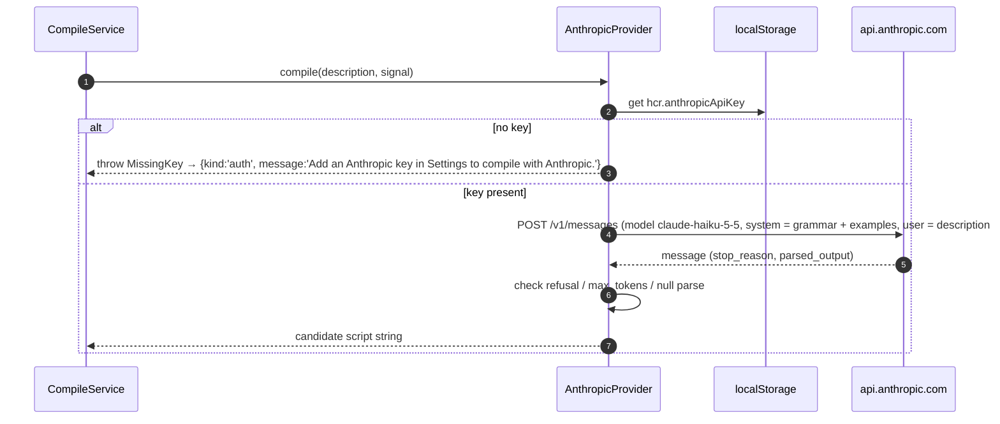

# Design: Flip Card

Status: reviewed (cloud session #2). Companion documents: `requirements.md` (what),
`tasks.md` (order of work), `docs/grammar.md` (the language), `examples/` (the six
bundled cards, machine-readable), `.kiro/steering/tech.md` (stack rules),
`.kiro/steering/kiro-usage.md` (how the spec is executed).

Every section below is written so that a task in `tasks.md` can be implemented from it
without asking a question. Where `requirements.md` leaves room, §11 records the
assumption taken; the glossary in `requirements.md` fixes the words *card*, *stored
script*, *run*, *the LLM*, *flip* and *commit*.

## 1. Overview

HyperCard Reborn is a TypeScript + Vite single-page application with **no backend at
runtime**. Everything the app needs ships in the static bundle: the parser, the
interpreter, the card store, the flip UI, the editor and the compile service. The only
network call the app ever makes is the one-time compile call to the Anthropic API, and
only when the user has chosen the BYOK (bring your own key) provider. With the offline
canned provider the app makes no network calls at all (requirement 4).

The design is organised around one invariant that satisfies requirements 1.2, 1.3, 2.2
and 3.3 at once:

> **A card's `script` string is the only executable artefact.** The interpreter runs
> the `Program` parsed from that exact string; the flipped card renders that exact
> string; the compile service's only job is to *propose* a new value for it, and the
> card store's `commitScript` is the only code path that can change it, and it refuses
> anything that does not parse.

## 2. Module map

```
src/
  parser/        lexer.ts, parser.ts, ast.ts, errors.ts, printer.ts, arbitraries.ts (test-only generators)
  interpreter/   interpreter.ts, values.ts, host.ts, fakeHost.ts (test-only)
  store/         cardStore.ts, persistence.ts, seed.ts, types.ts
  compile/       compileService.ts, normalise.ts, prompt.ts, types.ts, providers/anthropic.ts, providers/canned.ts
  examples/      index.ts                      (imports ../../.kiro/specs/flip-card/examples/*.hc/* with ?raw)
  runtime/       cardRuntime.ts, domHost.ts    (wires store + interpreter + host; owns "run")
  ui/            app.ts, cardView.ts, frontFace.ts, backFace.ts, editor.ts, descriptionPanel.ts,
                 errorPanel.ts, settings.ts, dialogs.ts, dom.ts
  main.ts
docs/grammar.md                              (imported at build time with `?raw` by compile/prompt.ts)
```

| Module | Responsibility | May import | Must not import |
|---|---|---|---|
| `parser` | `parse(source): ParseResult` (total: never throws). `print(program): string` for tests. | nothing from `src/` | everything else |
| `interpreter` | `run(program, handler, host, options): RunResult`. Pure over a `Host` interface; no DOM, no store. | `parser` | `compile`, `store`, `ui`, `runtime`, `@anthropic-ai/sdk` |
| `store` | Owns `Card[]`, the `commitScript` invariant, persistence to `localStorage`, seeding. | `parser`, `examples` | `compile`, `ui`, `interpreter`, `runtime`, `@anthropic-ai/sdk` |
| `examples` | The six `{id, title, description, script, objects}` records. | nothing from `src/` (raw file imports only) | everything |
| `compile` | `compile(description, provider, signal): Promise<CompileResult>`. Calls a provider once, parses the result, returns a validated script or a `CompileError`. Never writes to the store. | `parser`, `examples`, `@anthropic-ai/sdk`, `zod` | `store`, `interpreter`, `ui`, `runtime` |
| `runtime` | `CardRuntime`: given a card snapshot, parses `card.script`, builds a DOM-backed `Host`, sends `openCard`, routes button clicks to `mouseUp`, exposes `currentProgram(id)` for the byte-identity check. | `parser`, `interpreter`, `store` | `compile`, `ui`, `@anthropic-ai/sdk` |
| `ui` | Rendering, events, editor draft state, error panels, settings (provider + key), dialogs. | `store`, `runtime`, `parser` (types), `examples`; `compile` **only via dynamic `import()`** | `interpreter` directly, `@anthropic-ai/sdk` |

These rules are the ones in `tech.md` and are enforced with ESLint `no-restricted-imports`
(task 1.3). The rule that matters most for requirement 1.3 is *the interpreter, runtime
and store cannot import the compile module*, so a running card has no code path to the LLM.

## 3. Card data model

```ts
// src/store/types.ts
export interface Card {
  id: string;                 // the example id for seeded cards ('hello'); crypto.randomUUID() otherwise
  number: number;             // 1-based position in the stack; `go to card N` uses this
  name: string;               // shown in the header ("Hello")
  description: string;        // natural language, as last saved by the author
  script: string;             // THE executable artefact. Verbatim: no trim, no newline normalisation.
  scriptOrigin: ScriptOrigin; // provenance for the back face; informational only
  objects: CardObject[];      // front-face layout, in z-order (later = on top)
  updatedAt: string;          // ISO-8601
}

export type ScriptOrigin =
  | { kind: 'compiled'; provider: 'anthropic' | 'canned'; model?: string; descriptionHash: string; at: string }
  | { kind: 'edited'; at: string }
  | { kind: 'seed' };         // bundled example card, never compiled in this browser

export interface CardObject {
  kind: 'field' | 'button';
  name: string;               // what scripts refer to: field "name" / button "name"; unique per card, case-insensitive
  visible: boolean;           // initial visibility; scripts change the live copy, not this
  enabled?: boolean;          // buttons only; default true
  text?: string;              // fields only: initial text; default ''
  rect: { x: number; y: number; w: number; h: number };   // px on a 512 x 342 card canvas
}
```

Notes on the model:

- `script` is a plain string, never an AST. The AST is derived on every run and never
  persisted, so there is no second representation that could drift (requirement 2.2).
- `descriptionHash` is `hex(SHA-256(utf8(normalise(description))))` with `normalise`
  from §6.3, computed with `crypto.subtle.digest` by the compile service and returned in
  `CompileResult`. The UI shows "compiled from an older description" when the hash of
  the current description differs from the stored one. It never triggers a compile.
- Field *text*, *visibility*, *enabled* and *name* at runtime are live state owned by the
  `Host`, seeded from `objects` on every run. They are never written back to the card,
  so "run" (requirement 3.2) always starts from the same initial state.
- Persistence: the `Card[]` array is serialised with `JSON.stringify` into
  `localStorage['hcr.cards.v1']`. JSON string encoding is lossless for the strings this
  app produces, so the round trip preserves `script` byte-for-byte. A `v1` suffix leaves
  room for a migration later. If the key is missing, is not valid JSON, or fails the
  schema check (an array of objects with the fields above and string `script`), the
  store re-seeds from `examples` and overwrites the key.

### 3.1 Store API

```ts
interface CardStore {
  getCards(): readonly Card[];                              // sorted by number
  getCard(id: string): Card | undefined;
  getCardByNumber(n: number): Card | undefined;
  saveDescription(id: string, description: string): void;   // never touches script
  commitScript(id: string, script: string, origin: ScriptOrigin): CommitResult;
  resetToSeed(): void;                                      // replaces every card with the bundled six
  subscribe(listener: (change: StoreChange) => void): () => void;
}

type CommitResult =
  | { ok: true; card: Card }
  | { ok: false; error: ParseError; card: Card };            // card is unchanged

type StoreChange =
  | { kind: 'description'; id: string }
  | { kind: 'script'; id: string }
  | { kind: 'reset' };
```

`commitScript` runs `parse(script)` first and returns `{ok:false}` without mutating
anything if it fails. This is the mechanism behind requirements 1.4 and 3.4: the
"previous script" is kept simply because nothing replaced it. On success it sets
`updatedAt` and `scriptOrigin`, persists, and notifies subscribers once.

### 3.2 Seeded cards

The six bundled cards (`examples/`, order = stack order) have these layouts. Every field
is an editable `<textarea>` so the user can type into it (the greeter and quiz cards
need that). Rects are `x, y, w, h` on the 512 × 342 canvas.

| # | id | name | objects (kind `name`: initial text / visibility, rect) |
|---|---|---|---|
| 1 | `hello` | Hello | field `greeting`: '' visible (32, 40, 448, 60) |
| 2 | `counter` | Counter | field `count`: '' visible (32, 40, 200, 40); button `Increment` (32, 100, 160, 32) |
| 3 | `date-stamp` | Date stamp | field `stamp`: '' visible (32, 40, 300, 40); button `Stamp` (32, 100, 160, 32) |
| 4 | `greeter` | Greeter | field `name`: '' visible (32, 40, 300, 40); button `Greet` (32, 100, 160, 32) |
| 5 | `countdown` | Countdown | field `list`: '' visible (32, 40, 200, 260); button `Go` (260, 40, 120, 32) |
| 6 | `quiz` | Quiz | field `question`: '' visible (32, 40, 448, 40); field `answer`: '' visible (32, 100, 200, 40); button `Check` (260, 100, 120, 32) |

Seeded cards have `scriptOrigin: { kind: 'seed' }`, `id` equal to the example id,
`description` and `script` byte-identical to `examples/<id>.hc/`, and `updatedAt` set to
the seeding time. `date-stamp` starts visible on purpose: its `openCard` hides the field,
which is what the demo shows.

## 4. Parser

### 4.1 API

- Hand-written lexer + recursive-descent parser for the grammar in `docs/grammar.md`.
  No parser generator: the grammar is small, error messages must be hand-tuned, and the
  bundle stays dependency-free.
- `parse(source: string): ParseResult` where
  `ParseResult = { ok: true; program: Program } | { ok: false; error: ParseError }`.
  It is total: any `string` input returns, never throws. A fast-check property test
  feeds arbitrary strings to prove it.
- `Program = { source: string; handlers: Handler[] }` where `source` is the exact input
  by reference equality. Nothing in the parser trims or normalises it.
- Every AST node carries `{ line: number; column: number }` of its first token, so
  runtime errors can point at a line.
- `ParseError = { line: number; column: number; message: string; near: string }` as
  specified in `docs/grammar.md` §6; `near` is the full text of the source line
  (without its newline) where the error occurred, or `''` at end of input.
- `printer.ts` pretty-prints a `Program` back to canonical source (two-space indent,
  `\n` newlines, lower-case keywords, handler names as written in `docs/grammar.md`).
  It exists for the round-trip property test and is not used by the app at runtime.
- `arbitraries.ts` defines the fast-check generators (`arbProgram`, `arbExpression`,
  `arbStatement`) once; every property test imports them from here.

### 4.2 Lexing details that the grammar leaves to the implementation

- Token kinds: `keyword`, `identifier`, `number`, `string`, `operator`, `newline`, `eof`.
  Each token carries `text` (the exact source slice), `line`, `column`.
- Keywords are matched case-insensitively against the reserved-word list in
  `docs/grammar.md` §1; `down` is a keyword only when followed by `to`, otherwise an
  identifier (so `down` can never be a variable name: it is reserved, see §1).
- `\r\n` is one `newline` token whose `text` is `\r\n`; column counting restarts at 1.
- An unterminated string is the parse error `expected closing quote, found newline`
  (or `found end of script`).
- End of input yields a synthetic `newline` token before `eof`, which is how "end of
  input counts as a newline" is implemented.

### 4.3 Parse error messages

Tests assert on the whole message. `X` and `Y` are substituted; tokens are quoted with
double quotes, structural positions are bare words.

| Situation | message |
|---|---|
| Wrong token | `expected X, found Y` where Y is `"text"`, `newline`, or `end of script` |
| Unknown character | `unexpected character "~"` |
| Unterminated string | `expected closing quote, found newline` / `... found end of script` |
| Second handler with the same name | `duplicate handler "mouseUp"` |
| `end` names a different handler | `expected "end mouseUp", found "end openCard"` |
| Unknown handler name | `expected "mouseUp" or "openCard", found "foo"` |
| Reserved word as variable | `expected a variable name, found "end"` |
| `put ... into button` | `cannot put into a button; use set name of button` |
| Unknown property in `set` | `expected "visible", "enabled" or "name", found "x"` |
| Block statement after single-line `then`/`else` | `a single-line if cannot contain "if" or "repeat"` |
| Statement outside a handler | `expected "on", found "put"` |

Positions: `line` and `column` are those of the offending token (`found Y`); for
`duplicate handler` they point at the second `on`.

## 5. Interpreter

### 5.1 Host interface

Tree-walking interpreter over the AST. Values are strings (`docs/grammar.md` §4). All
side effects go through a `Host` so the interpreter is testable with an in-memory fake
(`fakeHost.ts`) and the runtime can supply a DOM-backed one (`domHost.ts`):

```ts
export type ObjectKind = 'field' | 'button';

export interface Host {
  hasObject(kind: ObjectKind, name: string): boolean;           // case-insensitive, current names
  getFieldText(name: string): string | undefined;               // undefined = no such field
  setFieldText(name: string, text: string): boolean;            // false = no such field
  getName(kind: ObjectKind, name: string): string | undefined;  // current (possibly renamed) name
  setVisible(kind: ObjectKind, name: string, visible: boolean): boolean;
  setEnabled(name: string, enabled: boolean): boolean;          // buttons only
  setName(kind: ObjectKind, name: string, newName: string): boolean;
  answer(message: string): void;                                // queued modal; interpreter does not await it
  message(text: string): void;                                  // the message box / toast
  goToCard(n: number): boolean;                                 // false = out of range; deferred by the runtime
  now(): Date;                                                  // injectable for `the date` / `the time` tests
}
```

`FakeHost` keeps objects in a `Map`, records every call in `calls: HostCall[]` in order,
exposes `dialogs: string[]`, `messages: string[]`, `navigations: number[]`, and takes a
fixed `now` in its constructor.

### 5.2 Running a handler

```ts
export interface RunOptions { target: string }                  // '' for openCard
export interface RuntimeError { message: string; line: number; column: number; handler: string }
export type RunResult = { ok: true; statements: number } | { ok: false; error: RuntimeError };

export function run(program: Program, handler: 'mouseUp' | 'openCard', host: Host, options: RunOptions): RunResult;
```

- Finds the handler; a missing handler is `{ ok: true, statements: 0 }` (a card with
  only `on mouseUp` opens silently).
- Executes with a statement budget of 10,000: every statement node that begins
  executing decrements the budget; at 0 the run stops with `script ran too long`.
- Variables live in a `Map<string, string>` keyed by lower-cased name, created per run.
- Runtime errors stop the handler at the failing statement. Side effects already
  performed stay (a field already written stays written). The error is returned, never
  thrown; it never causes the store to roll anything back.
- `answer` and `goToCard` are recorded by the host and acted on by the runtime after
  `run` returns (§5.5). Nothing in `run` is asynchronous.

### 5.3 Value semantics

Exactly as in `docs/grammar.md` §4, with these implementation decisions:

- Numeric test: trim spaces and tabs, then `/^-?[0-9]+(\.[0-9]+)?$/`. Conversion with
  `Number()`. Rendering: if the result is an integer with magnitude below 1e21,
  `String(n)`; otherwise `n.toFixed(6)` with trailing zeros and a trailing `.` removed.
  Non-finite results are the runtime error `number out of range`.
- Every produced value is checked against the 64 KiB limit at the point it is produced
  (`&`, `&&`, arithmetic rendering, `put`); exceeding it is `value too long`.
- Booleans are the lower-case strings `true` / `false`; accepted case-insensitively.

### 5.4 Runtime error messages

| Situation | message |
|---|---|
| Field/button missing | `field "x" does not exist` / `button "x" does not exist` |
| Arithmetic on a non-number | `expected a number, found "abc"` (the offending value, truncated to 40 chars) |
| `/`, `div`, `mod` by zero | `division by zero` |
| Non-finite result | `number out of range` |
| `and`/`or`/`not`/`set visible`/`set enabled`/`repeat while` on a non-boolean | `expected true or false, found "x"` |
| `set enabled of field` | `field "x" has no enabled property` |
| `go to card` out of range | `card 7 does not exist` (the number after truncation) |
| `go to card` with a non-number | `expected a number, found "abc"` |
| Statement budget exhausted | `script ran too long` |
| Value over 64 KiB | `value too long` |

### 5.5 Deferred effects

The interpreter is synchronous. The `DomHost` queues `answer` dialogs and remembers at
most one `goToCard` request (the last one wins). After `run` returns, `CardRuntime`:

1. shows the runtime error in the status line, if any;
2. shows the queued dialogs one at a time (`<dialog data-testid="answer-dialog">`, an
   OK button, Enter closes); while a dialog is open the card's buttons are inert;
3. after the last dialog is dismissed, if a `goToCard` was recorded, navigates to that
   card (§7.1), which runs it.

So the quiz card shows "Correct!", and only when OK is pressed does card 2 open.

## 6. Compile-once pipeline

### 6.1 Flow and types

The compile service is invoked from exactly one UI action: **Save description**. It is
never invoked by the runtime, by the editor, or by loading the app.

```ts
// src/compile/types.ts
export interface CompileProvider {
  readonly id: 'anthropic' | 'canned';
  compile(description: string, signal: AbortSignal): Promise<string>;   // raw candidate script
}

export type CompileResult =
  | { ok: true; script: string; descriptionHash: string; provider: 'anthropic' | 'canned'; model?: string }
  | { ok: false; error: CompileError };

export type CompileError =
  | { kind: 'invalid-script'; message: string; parseError: ParseError; candidate: string }
  | { kind: 'no-canned-match' | 'auth' | 'rate-limit' | 'network' | 'refused' | 'truncated' | 'unknown'; message: string }
  | { kind: 'api'; status: number; message: string };

export function compile(description: string, provider: CompileProvider, signal?: AbortSignal): Promise<CompileResult>;
```

`message` is always a complete sentence naming the next step (`tech.md` conventions);
the exact texts are in §9.

```mermaid
sequenceDiagram
  autonumber
  actor Author
  participant UI as Back face (description panel)
  participant CS as CompileService
  participant P as Provider (Anthropic | Canned)
  participant Parser
  participant Store as CardStore
  participant RT as CardRuntime

  Author->>UI: edits description, clicks Save
  UI->>Store: saveDescription(id, text)
  UI->>CS: compile(text, provider)   (UI disables Save until this settles)
  CS->>P: compile(text)   -- exactly one call
  P-->>CS: candidate script (string)
  CS->>Parser: parse(candidate)
  alt parses
    Parser-->>CS: ok, program
    CS-->>UI: { ok: true, script: candidate, descriptionHash }
    UI->>Store: commitScript(id, candidate, {kind:'compiled',...})
    Store-->>UI: { ok: true, card }
    UI->>RT: run(card)   -- openCard
  else parse error (req 1.4)
    Parser-->>CS: error
    CS-->>UI: { ok: false, error: {kind:'invalid-script', parseError, candidate} }
    UI->>UI: show parse error + rejected candidate (read-only); previous script untouched
  else provider error
    P-->>CS: throws / refusal / no match
    CS-->>UI: { ok: false, error: {kind: 'auth'|'network'|'rate-limit'|'refused'|'truncated'|'no-canned-match'|'api'|'unknown'} }
    UI->>UI: show error; previous script untouched
  end
```

"Exactly once" (requirement 1.1) is guaranteed by three things:

1. `compile` makes a single provider call with no retry loop of its own. The Anthropic
   SDK's transport-level retries (`maxRetries`) are set to `0` so a network hiccup is
   reported, not silently re-sent.
2. The UI holds a per-card `compiling` flag and disables Save while a compile is in
   flight, so a double click cannot start a second call.
3. The Anthropic provider is the only module that imports `@anthropic-ai/sdk`, and the
   compile module is importable only from `ui/`. There is no other call site.

### 6.2 Provider contract

The provider returns a raw string; the service, not the provider, decides whether it is
valid by parsing it. That keeps the validation rule in one place and identical for both
providers. A provider signals failure by throwing one of the error classes in
`src/compile/types.ts` (`MissingKey`, `NoCannedMatch`) or an SDK error; the service maps
them to `CompileError.kind` (§6.4) and never lets an exception escape.

### 6.3 Normalisation and the canned provider (offline, default)

`normalise(description)` in `src/compile/normalise.ts`, in this order:

1. replace every run of whitespace (`/\s+/g`) with one space;
2. trim;
3. lower-case (`toLowerCase()`);
4. remove one trailing `.` if present.

The canned provider looks `normalise(description)` up in a `Map` built from
`normalise(example.description)` for the six examples. Hit: returns the example's
script. Miss: throws `NoCannedMatch`. The description panel shows the six bundled
descriptions as one-click chips when this provider is active, so a demo never has to
type one exactly. The provider is synchronous in practice but keeps the async signature
so the UI is identical for both providers (same spinner, same disabled Save).

### 6.4 Anthropic provider (BYOK)

- Key: read from `localStorage['hcr.anthropicApiKey']` at call time, never cached in
  module state, never logged, never sent anywhere but `api.anthropic.com`. The settings
  panel writes it; a "Forget key" button removes it. The settings panel states plainly
  that the key lives in this browser's local storage and that a browser-held key is
  only appropriate for a personal key on a personal machine.
- Client: `@anthropic-ai/sdk` constructed per call with
  `new Anthropic({ apiKey, dangerouslyAllowBrowser: true, maxRetries: 0 })`.
  The browser flag is required by the SDK because the call leaves the key visible to
  the page; that is the explicit BYOK trade-off, documented in the README.
- Request: `client.messages.create` on model `claude-haiku-5-5` with
  - `max_tokens: 2048` (the largest bundled example is under 300 tokens; scripts are small),
  - structured output via `output_config.format` (`zodOutputFormat` of `z.object({ script: z.string() })`),
    so there is no fence-stripping and no prose to trim; the text block is decoded with that
    format object's own `parse(text)` after the `stop_reason` checks below. (Task 8.3 note:
    the design first named `client.messages.parse`; in `@anthropic-ai/sdk` 1.3.0 that helper
    parses eagerly and throws on a truncated body before `stop_reason` can be examined, so the
    branch order below would be unreachable. `create` plus the same helper's `parse` keeps the
    schema enforcement and the order.)
  - thinking and effort left at the model defaults; the task is small and the parser is the safety net,
  - no `temperature`, no assistant prefill, no `fallbacks`,
  - `system`: the compile prompt (§6.5), `messages`: one user turn containing the description verbatim.
- Response handling, in order:
  1. `stop_reason === 'refusal'` → `{kind:'refused'}`.
  2. `stop_reason === 'max_tokens'` → `{kind:'truncated'}`.
  3. The text block does not decode as `{ script }` → the raw text is returned as the
     candidate, so the service's parse of it yields `{kind:'invalid-script'}` with that
     candidate and parse error.
  4. Otherwise return `parsed_output.script` as the candidate; the service parses it.
- Error mapping (most specific first): `Anthropic.AuthenticationError` → `auth`,
  `Anthropic.RateLimitError` → `rate-limit`, `Anthropic.APIUserAbortError` and
  `Anthropic.APIConnectionError` → `network`, any other `Anthropic.APIError` → `api` with
  its `status`, `MissingKey` → `auth`, anything else → `unknown`. The provider throws a
  `ProviderError` carrying the kind; the service turns it into the §9 message, so the SDK
  stays imported from this one file.
- Timeout: 30 s. The provider combines the caller's signal with
  `AbortSignal.timeout(30_000)` via `AbortSignal.any`; an abort is reported as `network`.
- The SDK fields named above are the ones the implementation targets; task 8.3 verifies
  them against the installed SDK version's types and records any rename in the task notes
  rather than silently changing the design.



### 6.5 Compile prompt

`src/compile/prompt.ts` exports `buildSystemPrompt(grammar: string, examples: Example[]): string`,
a pure function, and `SYSTEM_PROMPT` built from:

1. `docs/grammar.md`, imported with Vite's `?raw` suffix at build time.
2. The six examples from `src/examples/`, rendered as
   `Description: <description>\n\n<script>` pairs separated by a blank line.

Plus a short rule block: output only a script; use only the handlers, statements and
built-ins in the grammar; reference objects by the names given in the description; if
the description asks for something the grammar cannot express, implement the closest
thing it can and do not invent syntax. The prompt is unit-tested as a snapshot.

### 6.6 Provider selection

Settings panel → radio: *Offline (bundled examples)* or *Anthropic (my key)*. The choice is
stored in `localStorage['hcr.compileProvider']` as `'canned' | 'anthropic'` and defaults
to `canned` (requirement 4.1), so a fresh clone works with no key and no network.
Switching provider never touches any script.

### 6.7 Example extraction rule (the consistency test)

`src/examples/consistency.test.ts` reads `docs/grammar.md`, takes the text between the
line `## 8. Example scripts` and the next line starting with `## `, and matches, with the
`s` flag, every

```
### Example <N>: `<id>`\n\n**Description:** <description>\n\n```hypertalk\n<script>```\n
```

where `<description>` is one line and `<script>` is everything up to the closing fence,
including its final newline. It asserts: exactly six matches; `N` is 1..6 in order; for
each, `examples/<id>.hc/description.txt` equals `<description>` byte-for-byte and
`examples/<id>.hc/script.hc` equals `<script>` byte-for-byte (compared as `Uint8Array`);
`src/examples/index.ts` exports the same six in the same order with the same bytes; every
script parses; and every reserved word in the `docs/grammar.md` §1 list is a key of the
lexer's keyword table and vice versa.

## 7. App shell and flip UI

### 7.1 App shell and navigation

The app shows **one card at a time**. The header has the card's name, `Card N of 6`,
Previous / Next buttons and a Settings button. Whenever a card becomes the visible card
(on load, Previous/Next, or `go to card`), the runtime **runs** it (reset live state
from `objects`, send `openCard`). Leaving a card tears down its host; flip state is
per card and a card is always shown front first. Card 1 is shown on load.

### 7.2 The two faces

Each card is one DOM element with two faces and a `data-face="front" | "back"`
attribute. The flip action toggles the attribute; CSS does the 3-D transform. Both faces
are always in the DOM, so flipping is instant and the running card is never torn down.
Users who prefer reduced motion get an instant swap (`prefers-reduced-motion`).

- **Front face**: the card's objects (fields as `<textarea>`, buttons as `<button>`),
  absolutely positioned from `rect` on the 512 × 342 canvas, scaled down to fit narrow
  viewports; a status line for runtime errors; the message box; the Flip control.
- **Back face**: two columns. Left: the description (editable `<textarea>`) with Save,
  the provider chips, the compile-error block, the stale-description notice, the script
  origin line ("compiled from this description with Anthropic claude-haiku-5-5 at …" /
  "compiled offline at …" / "edited by hand at …" / "bundled example"). Right: the script
  editor labelled *Draft*, Commit, the parse-error panel, and the read-only *Stored
  script* view. On viewports narrower than 720 px the columns stack (§11.4).

```mermaid
sequenceDiagram
  autonumber
  actor Viewer
  participant UI as CardView
  participant Store as CardStore
  participant RT as CardRuntime

  Viewer->>UI: click Flip
  UI->>Store: getCard(id)
  UI->>RT: currentProgram(id).source
  UI->>UI: assert program.source === card.script   (dev build; also a unit test)
  UI->>UI: backFace.render(card)
  UI->>UI: data-face = "back"
  Viewer->>UI: click Flip again
  UI->>UI: data-face = "front"   (req 2.3; nothing is re-run)
```

### 7.3 `data-testid` contract

Playwright selects only by these names. Adding one is fine; renaming one needs a
change here first.

| Element | `data-testid` |
|---|---|
| Card root, front face, back face | `card`, `card-front`, `card-back` |
| Flip control (both faces) | `flip` |
| Header | `card-name`, `card-position`, `card-prev`, `card-next`, `settings-open` |
| Front-face objects | `field-<name>`, `button-<name>` (name lower-cased, spaces to `-`) |
| Status line, message box | `status-line`, `message-box` |
| Answer dialog and its OK | `answer-dialog`, `answer-ok` |
| Description panel | `description-input`, `save-description`, `chip-<id>`, `compile-error`, `compile-candidate`, `stale-notice`, `script-origin` |
| Editor | `script-editor`, `commit-script`, `parse-error`, `stored-script` |
| Settings | `settings-panel`, `provider-canned`, `provider-anthropic`, `api-key`, `forget-key`, `reset-cards`, `settings-close` |

### 7.4 How requirement 2.2 (byte identity) is guaranteed

There is exactly one string, and every consumer reads it from the same place:

| Consumer | What it reads | How |
|---|---|---|
| Interpreter | `program`, where `program = parse(card.script).program` and `program.source === card.script` (reference equality; the parser does not copy or normalise). | `CardRuntime.run(card)` |
| Back face | `card.script` from the same `Card` snapshot the runtime was given. | `backFace.render(card)` |
| Editor | A separate `draft` string in UI state, initialised from `card.script` when the back face opens, and only ever written to the store via `commitScript`. | `editor.ts` |

Three further rules close the gaps where bytes usually get lost:

1. **No normalisation anywhere on the write path.** `commitScript` stores the string it is
   given. The editor commits `textarea.value` verbatim. Line endings, trailing whitespace
   and a missing final newline are preserved. (A `<textarea>` normalises `\r\n` to `\n`
   on *input*; that happens before commit, so stored and displayed are still identical.)
2. **No normalisation on the read path.** The read-only script view sets `textContent`
   on a `<pre>` with `white-space: pre`; it never goes through `innerHTML`, `trim`, or a
   syntax highlighter that re-tokenises. If highlighting is added later it must be
   implemented as an overlay that does not touch the text node.
3. **A stale draft is never shown as "the script".** The editor is labelled *Draft* until
   commit, and the read-only *Stored script* view sits next to it so the viewer can
   always see what actually runs even while editing.

Verification:

- Unit test: for every bundled card, `runtime.currentProgram(card.id).source === store.getCard(card.id).script`.
- fast-check property: for arbitrary strings `s` that parse, `commitScript(id, s)` then
  `getCard(id).script === s` and `runtime.currentProgram(id).source === s` (both with `===`
  and with a byte comparison of `new TextEncoder().encode(...)`, which is what "byte-identical" means for the UTF-8 bundle).
- A dev-mode assertion in `backFace.render` that throws if the two differ.
- Playwright: read the `<pre>`'s `textContent` and compare it to `localStorage` state.

## 8. Editor and re-run (requirement 3)

```mermaid
sequenceDiagram
  autonumber
  actor Author
  participant Ed as Editor (back face)
  participant Store as CardStore
  participant Parser
  participant RT as CardRuntime
  participant EP as Error panel

  Author->>Ed: edits draft, presses Commit (or Ctrl/Cmd+Enter)
  Ed->>Store: commitScript(id, draft, {kind:'edited'})
  Store->>Parser: parse(draft)
  alt parses
    Parser-->>Store: ok
    Store-->>Ed: { ok: true, card }
    Ed->>EP: clear
    Ed->>RT: rerun(card)   -- tear down host state, seed from objects, send openCard
    RT-->>Ed: run result (runtime errors go to the front-face status line)
  else parse error (req 3.4)
    Parser-->>Store: error
    Store-->>Ed: { ok: false, error, card (unchanged) }
    Ed->>EP: show line:col + message + near; highlight the line in the draft
    Note over RT: last valid script keeps running; nothing was re-run
  end
```

- "Commit" is explicit: a button and the keyboard shortcut. Blur does not commit, so a
  half-typed script never triggers a parse error or a re-run. Commit is a no-op when the
  draft equals the stored script (no re-run, no error).
- The editor never calls the compile service (requirement 3.3). It has no import of it.
- Re-run semantics: the runtime discards live field text and visibility, re-seeds them
  from `card.objects`, parses `card.script` and sends `openCard`. The front face updates
  even while the card is still showing its back face, so flipping back shows the result.
- The draft survives a flip to the front and back again; it is discarded when the card
  is navigated away from or when a Save compiles a new script (the draft is then reset
  to the new stored script).

## 9. Error handling summary (requirements 1.4 and 3.4)

| Situation | Where it surfaces | What is stored | What runs |
|---|---|---|---|
| Compiled output fails to parse (1.4) | Back face, description panel: parse error with line:col, plus the rejected candidate in a read-only block so the author can copy it into the editor and fix it | Description (already saved); previous script untouched | Previous script, uninterrupted |
| Provider error (auth, network, rate limit, refusal, truncated, no canned match, api, unknown) | Same panel, one line, with the next step | Description; previous script untouched | Previous script |
| Edited script fails to parse (3.4) | Back face, next to the editor; offending line highlighted; the draft is kept so the author can keep editing | Nothing | Last valid script, uninterrupted |
| Runtime error during a handler | Front-face status line (and mirrored on the back face) | Nothing | Handler aborted at the failing statement; next event runs again |
| Card whose script is the empty string | As 1.4 | Script stays the empty string | The empty script, which parses and does nothing |

The empty string is a valid script (zero handlers), which is what makes the "keep the
previous script" rule total: there is always a previous script.

Compile error messages (shown verbatim):

| kind | message |
|---|---|
| `invalid-script` | `The compiler produced a script that does not parse (line L, column C: <parse message>). The previous script is still running.` |
| `no-canned-match` | `The offline compiler only knows the six bundled descriptions. Pick one from the list, or add an Anthropic key in Settings.` |
| `auth` | `Add an Anthropic key in Settings to compile with Anthropic.` (missing) / `Anthropic rejected the key. Check it in Settings.` (401) |
| `rate-limit` | `Anthropic is rate-limiting this key. Wait a moment and press Save again.` |
| `network` | `Could not reach api.anthropic.com. Check the connection and press Save again.` |
| `refused` | `The model declined to compile this description. Rephrase it and press Save again.` |
| `truncated` | `The model's answer was cut off. Shorten the description and press Save again.` |
| `api` | `Anthropic returned an error (HTTP <status>). Press Save to try again.` |
| `unknown` | `Compiling failed for an unexpected reason: <error message>.` |

## 10. Runtime "no LLM" guarantee (requirements 1.2, 1.3, 4.3)

- Static: ESLint `no-restricted-imports` forbids `src/compile/**` and `@anthropic-ai/sdk`
  from `src/interpreter/**`, `src/runtime/**`, `src/store/**` and `src/parser/**`, and
  forbids static import of `src/compile/**` from `src/ui/**`.
- Build: `vite build` produces a `compile` chunk via a dynamic `import()` from the
  description panel, so the SDK code is not even loaded until the author presses Save.
  The runtime chunk does not reference it; a test greps the built chunks.
- Test: a Playwright test runs every bundled card, clicks every button, flips every
  card, and asserts via `page.on('request')` that zero requests leave the page after load.

## 11. Resolved questions (assumptions taken)

These are places where `requirements.md` leaves room for interpretation. The design
proceeds on the following, now written into the glossary or the sections above:

1. "Run" (1.2, 3.2) means: reset live state from `objects`, then send `openCard`.
2. A repeat Save with an unchanged description still compiles again (one save, one call).
3. The canned provider counts as "the LLM" for the purpose of 1.1 (glossary), so the
   pipeline is identical and 1.3 and 4.3 are testable offline.
4. "Side by side" (2.1) tolerates stacking below 720 px; at 720 px and above the two
   columns are side by side.
5. The stack is the six seeded cards; `go to card N` navigates within it (§7.1). Out of
   range is the runtime error `card N does not exist` and the current card stays.
6. Field text typed by the user is live state (the DOM host reads the textarea), so
   `field "answer"` sees what the user typed; a re-run discards it.

## 12. Non-goals (this spec)

Card creation and deletion UI, layout editing, stack import/export, syntax highlighting,
undo history of scripts, multiple-handler object scripts, any server component.
