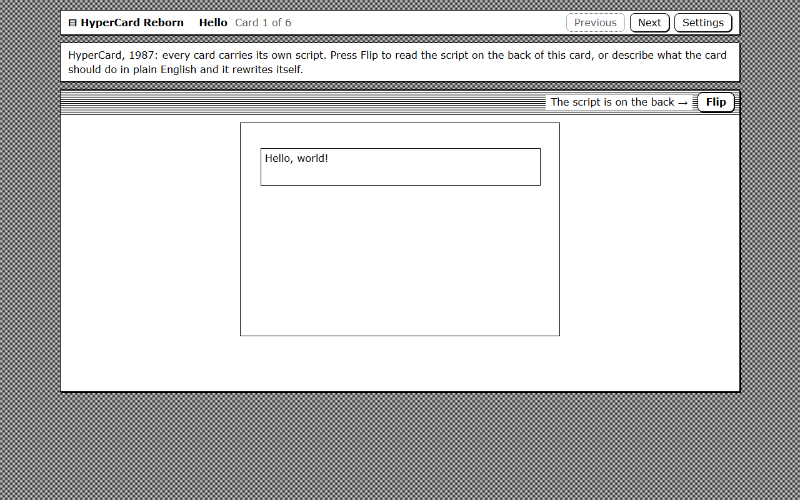
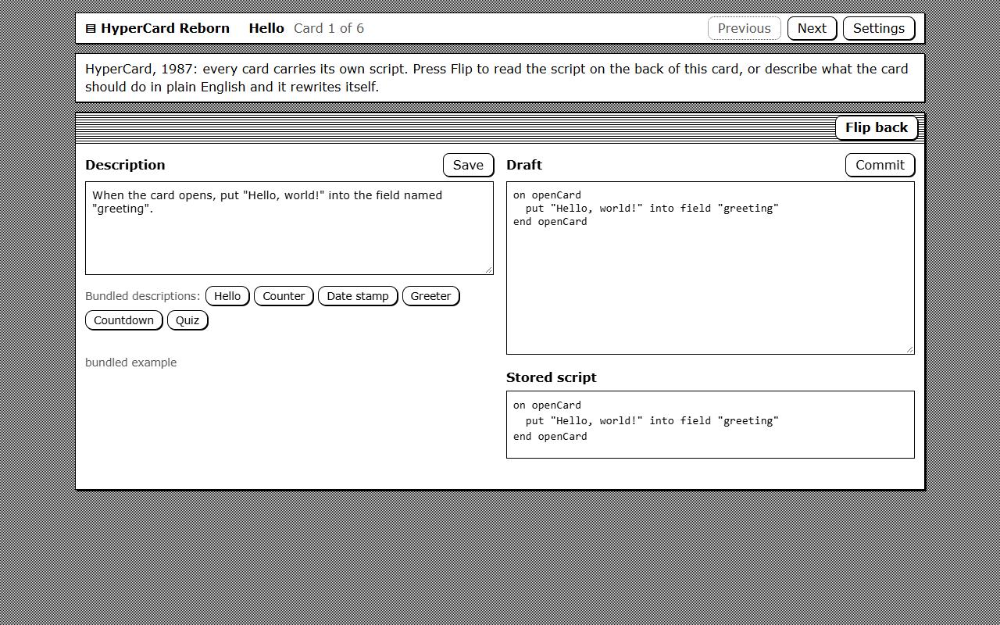

# HyperCard Reborn

Kiroween 2026 · Resurrection · HyperCard reborn — every card can be flipped to show the script that actually runs.

**Live demo:** https://run58669-maker.github.io/hypercard-reborn/ (one static file, works offline, no key needed)

| Front: the card running | Back: the description and the script that runs |
|---|---|
|  |  |

## Pitch

In 1987 HyperCard let anyone build software by describing what a button should do, in
something close to English, and the stack ran exactly what you wrote. HyperCard Reborn
brings that promise to the browser with one twist: you write the description in actual
English, an LLM compiles it **once** into a tiny HyperTalk-subset script, and that script
is stored on the card. From then on the model is out of the loop. The card runs on our
own interpreter, in your browser, with no server and no network.

Flip any card and you see both halves side by side: the sentence you wrote and the script
that runs. The script is editable. Commit an edit and the card re-runs immediately. The
model is never consulted for an edit, and the script you see is byte-for-byte the script
that executes.

Hackathon scope is the flip action and nothing else: the flip-card view, the compile-once
pipeline (bring-your-own Anthropic key, or an offline canned compiler for the six bundled
cards), and edit-and-rerun.

## Status

Implemented: the flip-card spec in `.kiro/specs/flip-card/tasks.md` is executed through
task 14. The app runs offline with the six bundled cards, every card flips to show its
description and the script that runs, scripts are editable with an immediate re-run, and
the compile-once pipeline works with the offline provider or your own Anthropic key.
The first screen carries a one-sentence introduction and a pointer to **Flip**, and the
styling is one-bit black and white in the manner of a 1987 compact Mac (CSS only, no
images or web fonts).

- `.kiro/steering/product.md` and `.kiro/steering/tech.md` for scope and stack rules
- `.kiro/specs/flip-card/requirements.md`, `design.md`, `tasks.md` for the spec, and `examples/` for the six bundled cards
- `.kiro/specs/flip-card/BLOCKED.md` for the one verification step that could not run in the build environment and notes on task wording
- `docs/grammar.md` for the language and the six example cards
- `docs/traceability.md` for the test that covers each acceptance criterion
- `docs/demo.md` for the demo recording checklist
- `docs/REVIEW.md` for the judge-style self-review and the fixes it led to

## Running

Node 22 and npm. `npm install` also points git at `.githooks/`, so every commit runs the
unit and property tests first.

```bash
npm install
```

```bash
npm run dev
```

The dev server prints its URL (usually `http://localhost:5173`). The other commands:

```bash
npm test
```

Vitest unit and fast-check property tests, the module-boundary check and the bundle check
(which builds once into a temporary directory).

```bash
npm run test:e2e
```

Playwright against `vite preview` on port 4173; it builds first. On a fresh clone run
`npx playwright install --with-deps chromium` once so the browser is present.

```bash
npm run lint
```

```bash
npm run typecheck
```

```bash
npm run build
```

The production bundle is one self-contained `dist/index.html` that opens from `file://`
or any static host; there is no server. For a build with visible chunk boundaries (the
interpreter in one chunk, the compile module with the Anthropic SDK in another, reached
only through a dynamic `import()`), use:

```bash
npm run build:chunks
```

```bash
npm run preview
```

Serves `dist/` on `http://localhost:4173`.

### Compile providers

- **Offline (default):** the six bundled descriptions in `docs/grammar.md` compile with no key
  and no network. Pick one from the chips on the back of a card and press Save.
- **Anthropic (BYOK):** open Settings, choose *Anthropic (my key)* and paste your own API key.
  The app calls `claude-haiku-5-5` from the browser with structured output and makes exactly
  one request per Save. The key is stored in this browser's `localStorage` under
  `hcr.anthropicApiKey`, read only when you press Save on a description, and sent only to the
  Anthropic API. Because the call is made from the page, the key is visible to the page: that
  is the trade-off of bringing your own key, so use a personal key on a personal machine and
  press *Forget key* when you are done.

Whichever provider is selected, nothing calls it while a card runs or when you edit a script
by hand: the runtime executes only the stored script with the project's own interpreter, and
the Playwright isolation test counts zero network requests across every card, button and flip.

### 60-second demo (offline)

Start `npm run preview` (or open `dist/index.html`) in a fresh browser profile so the six
cards are seeded.

1. **Hello** (card 1 of 6): the greeting field already reads `Hello, world!`. Press **Flip**:
   the description on the left, the script that runs on the right. Flip back.
2. **Next** to **Counter**: press **Increment** three times, the field counts to 3.
3. **Next** to **Date stamp**: the field is hidden on open; press **Stamp** and today's date
   appears.
4. **Next** to **Greeter**: press **Greet** with an empty name, then type a name and press
   **Greet** again.
5. **Next** to **Countdown**: press **Go**; the list fills from 10 down to `Liftoff!`.
6. **Next** to **Quiz**: type `4` and press **Check**: `Correct!`, then OK takes you to
   card 2. Go back to card 6.
7. Flip the quiz card. In the *Draft* editor change `if field "answer" = 4 then` to
   `= 5`, press **Commit** (or Ctrl/Cmd+Enter). The card re-runs at once. Flip back, type
   `5`, press **Check**: `Correct!`.
8. Flip again, break the script (delete `end if`), Commit: the parse error appears next to
   the editor and the stored script, still running on the front, is unchanged.

## Working with Kiro

This project is spec-driven: the `.kiro/` directory came first and the code was written
against it, one `tasks.md` sub-task per commit. `.kiro/steering/kiro-usage.md` is the long
version; this is the short one.

### Who built what

Stated plainly, so nobody has to guess from the commit log:

| Part | Built by | Evidence |
|---|---|---|
| The spec, steering files and hooks in `.kiro/`, and `docs/grammar.md` | Claude Code sessions, reviewed by the author | commits `8431ca4`, `7c95a1a`, `266cae7`, `904949a` |
| Tasks 1.1 and 1.2 (Vite, TypeScript, Vitest, fast-check scaffold; ESLint flat config) | **Kiro**, executing the spec tasks from the Kiro spec view in autopilot | commit `1435f54`; `.kiro/specs/flip-card/tasks.meta.json` holds the execution ids Kiro wrote for both tasks |
| Tasks 1.3 to 14.3 (parser, interpreter, store, compile pipeline, runtime, UI, tests) | Claude Code, following the same `tasks.md` in order, one sub-task per commit | the 45 commits authored `Claude` and titled `flip-card <task number>` |
| CI fixes on Windows and for the boundary check, the phone-width fix, the first-screen introduction and the 1987 styling | Claude Code, outside the spec's task list; recorded afterwards as tasks 15.1 and 15.2 | pull requests #2, #3 and #4 |
| Requirement 5 (keyboard) and tasks 16.1 to 16.4 in the spec | Claude Code | commits `e9529ab`, `c087baa`, `56b2ddb` |
| Tasks 16.1 to 16.4 (arrow keys and Escape, the keyboard end-to-end spec, unit tests that can fail, focus after Escape, end cards, input methods) | **Kiro**, executing each task from the Kiro spec view; Claude Code checked each one and ticked 16.4 after the Kiro session stopped before marking it done | commits `734866d`, `00a669c`, `c6db824`, `0385195`; pull request #6 |
| Requirement 6 (a compiled script must fit the card's objects) and tasks 17.1 to 17.4: the object check, the `unknown-object` compile error, chips that are enabled only on the card they fit, the rewritten end-to-end test | Claude Code, in the spec and in the code; none of the four tasks was run in Kiro | commits `54130d5`, `20662be`, `bb0a9a7`, `424d407`, `e4d88fb` and the 17.4 commit |
| Requirement 7 (a script cannot trap the stack) and tasks 18.1 to 18.5: the 64-level nesting limit in the parser, the stop for `openCard` handlers that keep sending the stack on, the limit of 10 `answer` dialogs per run, repairing a card whose stored script does not parse, the browser tests | Claude Code, in the spec and in the code: 18.1 by a Claude Opus 5.5 agent, 18.2 to 18.5 by Claude Fable 5.2. A second model (GPT, through the Codex CLI) reviewed the first draft of the requirement and the design and found four holes; the requirement was revised before 18.2 to 18.5 were written. None of the five tasks was run in Kiro | commits `6dde7d4`, `bc9a60e`, `90ea42d`, `33f3d92`, `93a9acf`, `a2fb686` and the 18.5 commit (`bc9a60e`, the 18.1 commit, carries only the Fable 5.2 trailer: the session that committed it) |
| Tasks 18.6 to 18.8, after four reviews of 18.1 to 18.5 (three Claude review agents and GPT through the Codex CLI, all reading the code and running nothing): an error after `go to card` no longer moves the stack, a dialog the browser closes counts as OK, a card whose `openCard` sends the stack away is named in a notice and can be opened without running it (requirement 7.8), a run does a bounded amount of expression work (requirement 7.9) | Claude Code (Fable 5.2), in the spec and in the code. GPT had proposed a "pause scripts" switch for 7.8; `design.md` §5.7 says why a notice was built instead. None of the three tasks was run in Kiro | commits `a32b601`, `cf5ae9e`, `143952c`, `be94638` |
| Requirement 8 (a change that could not be stored is not shown as made) and tasks 19.1 to 19.5, which close what task 18.6 listed as open: a Commit, Save or Reset that the browser's storage refuses leaves the card as it was and says so; a Save that answers after a later Commit or Reset is dropped; the nesting tests assert results; tests for the arrow keys, Reset and Save as user actions; two corrections of wording | Claude Code (Fable 5.2), in the spec and in the code. None of the five tasks was run in Kiro | the five commits titled `flip-card 19.1` to `flip-card 19.5` |

So Kiro executed 6 of the 70 sub-tasks: 1.1, 1.2 and 16.1 to 16.4. The spec, steering
and hooks are real Kiro artefacts and Kiro ran against them, but most of the
implementation was not typed by Kiro's agent. The three hooks are configured in `.kiro/hooks/`, and the pre-commit gate
has a plain-git twin in `.githooks/` that ran on every commit; whether the two `askAgent`
hooks fired inside Kiro during those tasks was not recorded.

**Spec** (`.kiro/specs/flip-card/`)

| File | What it holds |
|---|---|
| `requirements.md` | 8 requirements, 39 EARS acceptance criteria, a glossary that fixes the contested words (*run*, *the LLM*, *commit*). |
| `design.md` | Module boundaries, the one invariant (`Card.script` is the only executable artefact), every public type, every parse and runtime error message, the six seeded card layouts, the `data-testid` contract, assumptions taken where the requirements leave room. |
| `tasks.md` | 19 groups, 70 sub-tasks, each sized for one Kiro execution with a *Done when* line and the `_Requirements_` it serves. Open the spec in Kiro and run them in order. |
| `examples/<id>.hc/` | The six bundled cards as `description.txt` + `script.hc`, byte-identical to `docs/grammar.md` §8. The app imports these files directly. |

`docs/grammar.md` is the language definition everything derives from: the parser
implements it, the compile prompt embeds it, the examples are checked against it.

**Hooks** (`.kiro/hooks/`)

| Hook | Fires on | Does |
|---|---|---|
| `parser-tests.kiro.hook` | edit under `src/parser/` | runs the parser unit + fast-check property tests, fixes without weakening tests, checks the grammar still matches |
| `grammar-examples-consistency.kiro.hook` | edit to `docs/grammar.md`, the spec examples, `src/examples/`, the compile prompt | keeps the four byte-for-byte in agreement, reports EBNF vs lexer drift |
| `pre-commit-tests.kiro.hook` | any shell command (`preToolUse`) | if the command is a `git commit`, runs `npm test` first and blocks the commit on failure (exit code 2) |

**Steering** (`.kiro/steering/`)

- `product.md` (always): the scope, one paragraph.
- `tech.md` (always): stack, ESLint-enforced module boundaries, invariants, Claude API rules.
- `kiro-usage.md` (always): the workflow, what is property-tested, what was deliberately not vibe-coded.
- `testing.md` (`fileMatch` on test files): fast-check and Playwright conventions.

**Property-based testing.** Every invariant in `tech.md` has a fast-check property named
in `tasks.md`: `parse()` never throws, lossless lexing, print/parse round trip, byte
identity through the store and the runtime, arithmetic against a reference evaluator.

**Not vibe-coded.** The grammar, the six examples, the error messages, the single
compile call and the no-LLM-at-runtime guarantee were fixed in the spec before any
implementation existed. The implementation follows them; the hooks and tests hold it to
the spec.

## License

MIT, see `LICENSE`.
